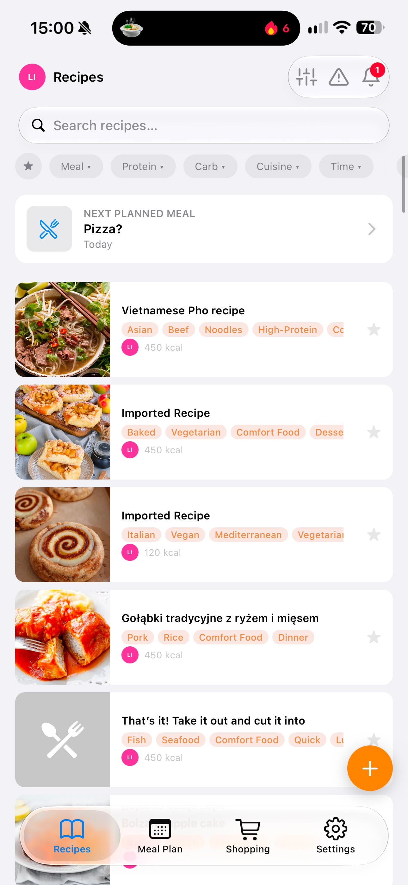
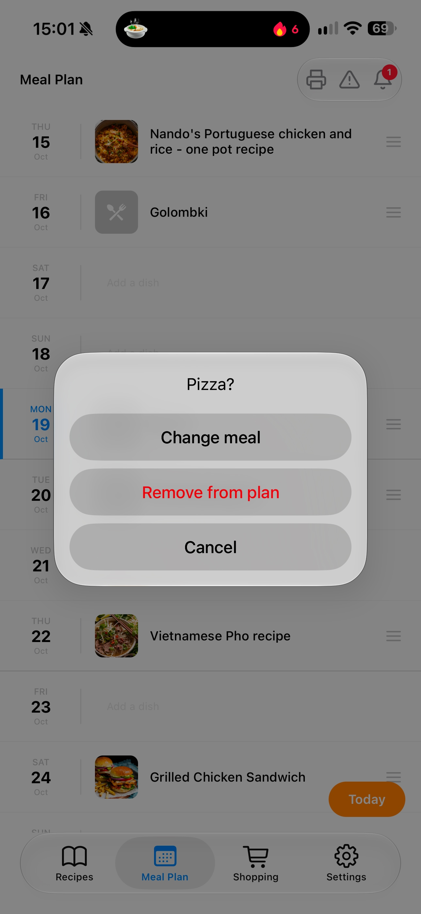
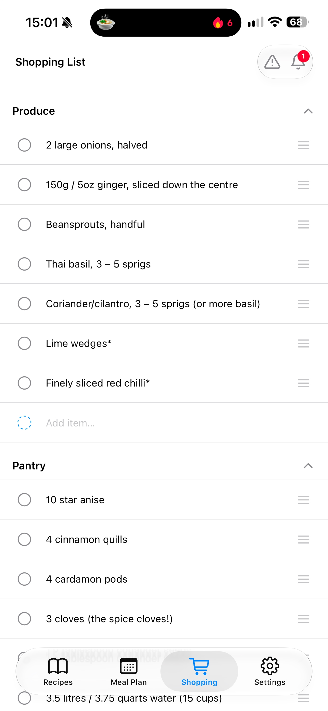
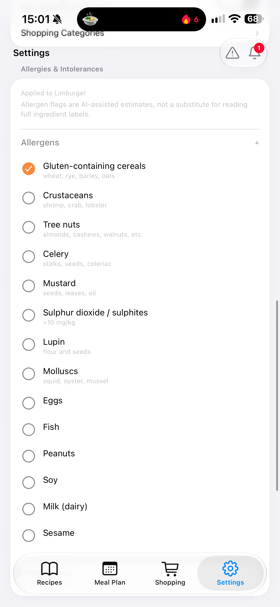
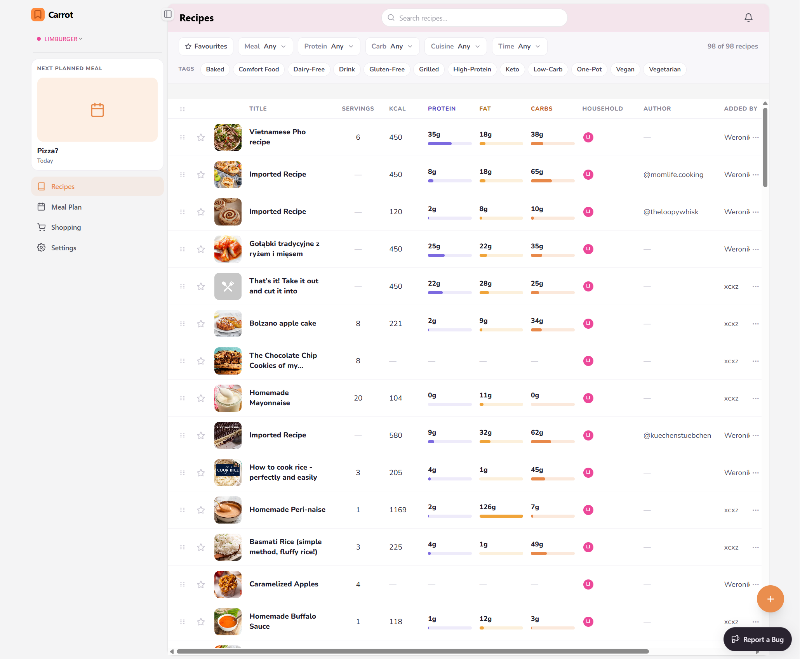
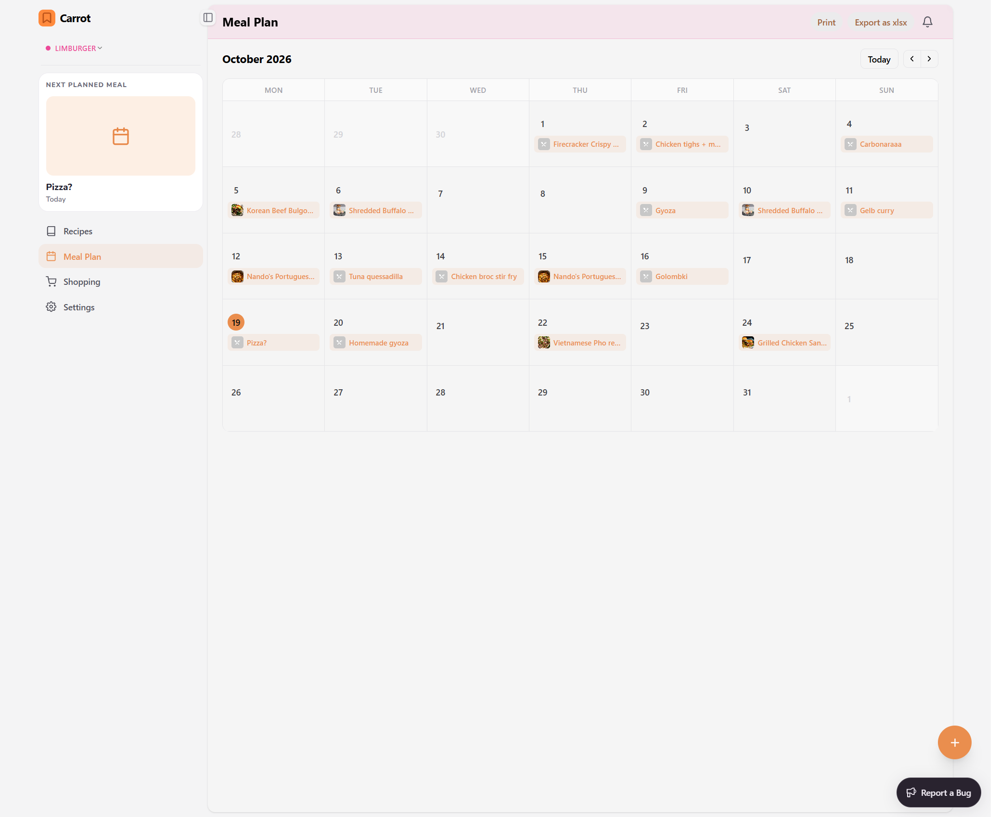
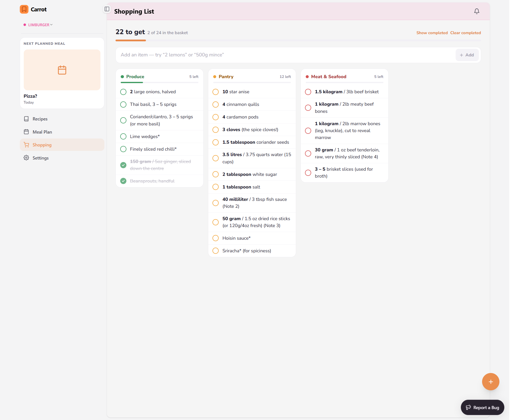
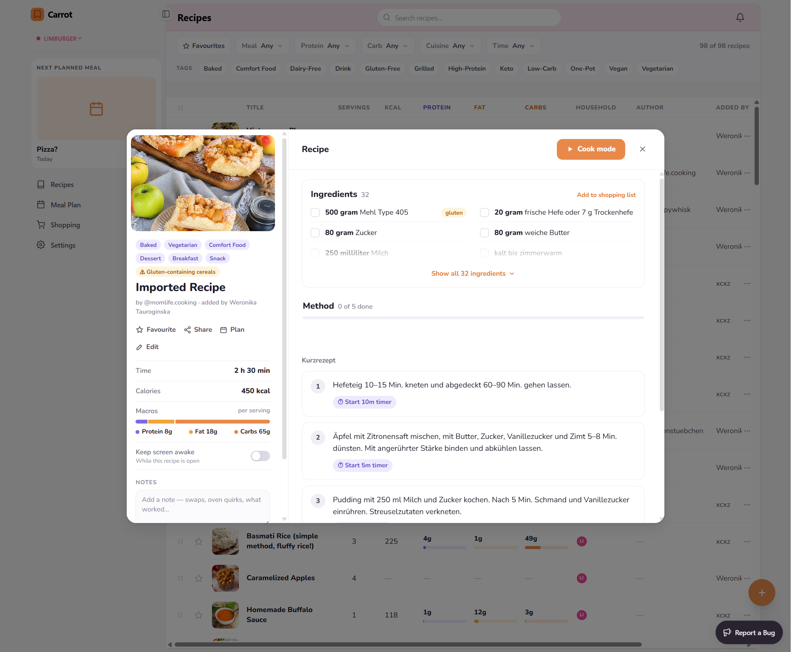
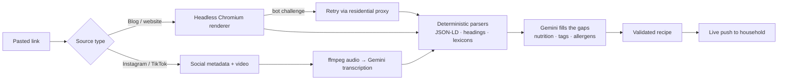

<div align="center">


# Carrot

### Any recipe. One link away. 🥕

Paste a link from a food blog or a social video, and Carrot's AI turns it into a clean, cookable recipe<br/>
with ingredients, steps and nutrition. Plan meals and share shopping lists with your whole household, kept in sync live.

<br/>


</div>

<br/>

<table>
  <tr>
    <td align="center"><br/><sub><b>Recipes</b></sub></td>
    <td align="center"><br/><sub><b>Meal plan</b></sub></td>
    <td align="center"><br/><sub><b>Shopping list</b></sub></td>
    <td align="center"><br/><sub><b>Allergens</b></sub></td>
  </tr>
</table>

<table>
  <tr>
    <td align="center"><br/><sub><b>Recipes</b></sub></td>
    <td align="center"><br/><sub><b>Meal plan</b></sub></td>
  </tr>
  <tr>
    <td align="center"><br/><sub><b>Shopping list</b></sub></td>
    <td align="center"><br/><sub><b>Recipe detail</b></sub></td>
  </tr>
</table>

## Features

- **AI recipe import:** works with websites and social videos. Imports run in the background.
- **Recipe library:** filter by meal, protein, carb, cuisine, time and tags, with semantic search.
- **Nutrition:** shows kcal, protein, fat and carbs for each recipe.
- **Households:** the recipes, meal plan and shopping list are shared and stay in sync live.
- **Meal plan and shopping lists:** shared with your household.
- **Allergens:** each recipe shows the allergens it contains.
- **Cook mode:** a step-by-step view built for use in the kitchen.
- **Five languages:** English, Polski, Deutsch, Français, Español.

## How it works

### Recipe import pipeline



1. **Queued, not blocking.** An import becomes a durable job in PostgreSQL. A separate worker container claims jobs with `SELECT … FOR UPDATE SKIP LOCKED`, so imports run in the background and survive restarts.
2. **Real browser rendering.** Many recipe sites are JavaScript-heavy or sit behind bot protection, so pages are rendered in a sandboxed **Playwright / headless Chromium** service. It caps concurrency, response size and timeouts, and skips images, media and fonts to keep renders fast.
3. **Proxy fallback.** Requests normally go out through an outbound proxy. When the page looks like a bot challenge, the renderer retries through a **residential SOCKS5 proxy**, so it sees the page as a normal visitor would.
4. **Deterministic first, AI second.** Structured data (JSON-LD) and hand-written parsers pull out ingredients, steps, yields and section headings, using lexicons for five languages. **Gemini** is only used for what the page doesn't state outright: picking the right text, estimating nutrition, tagging, and detecting allergens. The output is validated against strict Pydantic contracts.
5. **Video recipes.** For social videos, Carrot downloads the clip, extracts the audio with ffmpeg, transcribes it with Gemini, and then merges the spoken steps with the caption text.
6. **Everything is traced.** Every extraction records evidence and trace events, and an internal review tool (`tools/extraction-review`) replays captured payloads as regression fixtures.

### Allergens

Each recipe is checked against the allergens configured for the user and their household. Checks are **coalescing and durable**: if a recipe changes many times in a row, the queued requests collapse into a single recheck, and a result is only written if its hash shows it is newer than the stored one. Recipes are flagged on every device as soon as the check finishes.

### Technical highlights

- **Live collaboration:** a pub/sub broadcaster with presence. Shopping list edits appear instantly for everyone in the household, along with who else is viewing the list.
- **Semantic search:** pgvector and Gemini embeddings, with a feature flag for instant rollback and a resumable backfill.
- **SSRF-hardened fetching:** before fetching, every outbound URL is resolved and checked against private, loopback and link-local ranges, both in the API and in the renderer.
- **One codebase, three clients:** web (React + Vite), iOS and Android (Expo) share types and logic through `packages/shared`. The mobile app includes a share-sheet import and push notifications via APNs.
- **Repeat-tap safe:** user actions are idempotent end to end, so double-taps never create duplicate work.
- **Media storage:** recipe images are stored in Cloudflare R2.

## Deployment and CI/CD

Every push to `master` triggers a path-filtered GitHub Actions pipeline, separate for each deployable unit (API + worker + renderer, web, showcase):

1. **Test:** pytest for the API, plus the renderer's test suite running inside its hardened container (non-root, all capabilities dropped) on both **x86 and ARM** runners.
2. **Build:** multi-arch (`amd64` + `arm64`) Docker images built with Buildx, cached between runs, and pushed to GHCR with `latest` and commit-SHA tags.
3. **Deploy:** an SSH deploy to a VPS pulls the new images, restarts the services with Docker Compose, and **gates on a `/healthz` check**. If the API doesn't come up healthy, the job fails.

In production, Caddy terminates TLS and routes `/api/*` to the API container and everything else to the web container.

## Repository layout

| Path                                          | What it is                                       |
| --------------------------------------------- | ------------------------------------------------ |
| [apps/web](apps/web)                          | Web app (React + Vite)                           |
| [apps/mobile](apps/mobile)                    | iOS / Android app (Expo)                         |
| [apps/showcase](apps/showcase)                | Marketing site                                   |
| [packages/shared](packages/shared)            | Code shared between the apps                     |
| [services/api](services/api)                  | Backend API and import worker (FastAPI + PostgreSQL) |
| [services/renderer](services/renderer)        | Rendering service                                |
| [tools](tools)                                | Extraction review and fixture capture tooling    |
| [docs](docs)                                  | Specs, backlog, changelog and diagrams           |

## Prerequisites

- [pnpm](https://pnpm.io/) (`npm install -g pnpm`)
- [uv](https://docs.astral.sh/uv/) (Python package manager)
- [Docker](https://www.docker.com/) (for the database and worker)

## Running locally

1. Install dependencies:

   ```bash
   pnpm install
   cd services/api && uv sync && cd ../..
   ```

2. Copy `.env.example` to `.env` (used by Docker Compose). Copy `services/api/.env.example` to `services/api/.env` (used by the local API). Fill in the required values in both files.

3. Start the backend together with a client:

   ```bash
   pnpm be+web       # API + web app
   pnpm be+ios       # API + iOS app
   pnpm be+android   # API + Android app
   ```

   Each command starts the Docker Compose services (the database and the import worker) and the local API, then launches the client.

Web app: http://localhost:5173. Local API: http://localhost:8088

## Environment variables

| Variable          | Default                 | Description                  |
| ----------------- | ----------------------- | ---------------------------- |
| `ALLOWED_ORIGINS` | `http://localhost:5173` | CORS allowed origins         |
| `DATABASE_URL`    | —                       | PostgreSQL connection string |
| `SECRET`          | —                       | Auth secret                  |

## Semantic search rollout

Semantic recipe search uses `pgvector/pgvector:pg16` and Gemini embeddings. Deploy in this order: the database image first, then the API and the worker. Then queue a resumable backfill, which runs in batches:

```bash
docker compose exec worker uv run --no-sync python scripts/backfill_recipe_embeddings.py --batch-size 100
```

Run the command again until it reports `queued=0`. Then check that personal and household searches work. To roll back, set `SEMANTIC_SEARCH_ENABLED=false`. Semantic results switch off right away, while recipe saves and literal search keep working. Existing vectors are kept, so you can turn it back on later.

## License

<!-- TODO: no LICENSE file yet. Add one and name it here. -->
